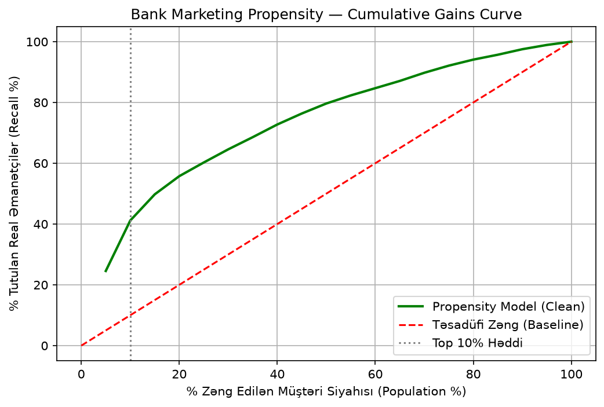

# ChurnLens

> Churn və propensity modelləri ilə "kimə zəng edək?" sualına cavab. Zəng siyahısının iqtisadiyyatı əsas göstəricidir, AUC deyil.

🎯 **Əsas nəticə:** Telco-da ən yuxarı 10%-ə zəng edəndə churn edənlərin **73.7%**-i tutulur (lift **2.78×**).

## Problem

ChurnLens bankda müştəri itkisinin (churn) qarşısını almaq üçün qurulub. Nümunə ssenari: bankda 100,000 müştəri var və hamısına tək-tək zəng etmək mümkün deyil, çünki resurs məhduddur. Model hər müştəriyə churn ehtimalı skoru (churn probability score, $p \in [0, 1]$) təyin edir və müştəriləri risk sırasına düzür. Resurslar (zəng mərkəzi, xüsusi kampaniyalar) yalnız ən yuxarı risk qrupuna, məsələn top 10%-ə yönəldilir.

Churn analitikasında geniş yayılmış yanlış fikir budur: "Bankı tərk etməyəcək müştərilərə resurs ayırmırıq, yalnız gedəcəklərə fokuslanırıq." Bu yanaşma natamamdır. Müştərilər üç qrupa bölünür:

1. **Sadiq müştərilər (Safe / Loyal):** Nə etsən də bankda qalacaqlar. Bunlara zəng edib endirim və ya hədiyyə təklif etmək bankın pulunu boşa xərcləməkdir.
2. **İtirilmiş müştərilər (Lost Causes):** Artıq qərarını verib, başqa banka keçib və ya xidmətdən tam narazıdır. Nə təklif etsən də qalmayacaq. Bunlara zəng etmək operatorun vaxtını boşa xərcləməkdir.
3. **Tərəddüddə olanlar / risklilər (Persuadables / At-Risk):** ChurnLens-in ovlamalı olduğu kütlə budur. Churn ehtimalı yüksəkdir ($p > 0.6$), amma doğru vaxtda doğru təklif (Next Best Offer / Product) edilsə, bankda qalacaqlar.

ChurnLens-in əsas məqsədi məhz bu üçüncü qrupu ayırmaqdır.

### Xərc balansı

- **Yanlış müsbət (False Positive, Type I):** Müştəri qalacaqdı, amma ona zəng edildi. Bankın xərci: operatorun 2 dəqiqəlik zəng vaxtı + 10 AZN-lik kiçik bonus və ya endirim (nümunə rəqəmlər). Maliyyət aşağıdır.
- **Yanlış mənfi (False Negative, Type II):** Müştəri gedəcəkdi, amma model onu tapmadı. Bankın xərci: müştərinin depozitləri, kredit faizləri və gələcək bütün mənfəəti, yəni CLV (Customer Lifetime Value), tamamilə itirilir. Maliyyət yüksəkdir.

Buna görə modelin uğuru yalnız AUC ilə deyil, bu xərc balansı ilə ölçüləcək.

Data: Telco (Kaggle, blastchar/telco-customer-churn) və Bank Marketing (UCI). Repo-da data yoxdur, data/raw/ altına qoyulmalıdır.
Necə işlədilir: pip install -r requirements.txt, sonra notebook-ları sırayla işlət.
Metod və nəticələr: Faza 1–8-in markdown nəticələri, əsas cədvəl (Telco və Bank müqayisəsi).
Məhdudiyyətlər: snapshot data, proxy bölmə, fərziyyəli biznes hesabı (save rate, CLV = aylıq × 12), propensity ≠ uplift, PSI eşikləri sənaye təcrübəsidir.
Nə deyil: production sistemi deyil, deployment yoxdur, real bank datası yoxdur.

## Nəticələr

| Layihə | Hədəf | ROC-AUC | Lift@10% |
|---|---|---|---|
| 🟦 Telco churn | Churn (26.5%) | 0.842 | 2.78× |
| 🟩 Bank propensity | Əmanət (11.7%) | 0.766 | 4.12× |